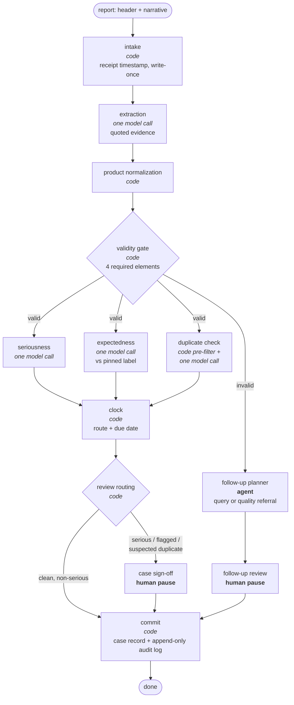

# PV case intake triage

## What this is

An agent system that triages incoming adverse event reports for six marketed drugs: lisinopril, metformin, warfarin, sertraline, atorvastatin and levothyroxine. For each report (a call-centre voicemail, a patient or HCP email, or a partner safety report) it decides:
- whether the report is a **valid case**;
- whether it is **serious**;
- whether each event is **expected** per the drug's approved label;
- whether it is a **duplicate** of a case already held;
- whether a **15-day FDA report** is due under 21 CFR 314.80.

A qualified human signs off on every serious case. Built with LangGraph, LangChain and LangSmith on `claude-sonnet-5-5`.

## Results

Held-out test split, 77 examples (23 requiring a 15-day report). **V2** is this system, mean of 3 runs. **V1** is a single-agent baseline with the same model and tools that decides everything itself, 1 run.

| | V2 (this system) | V1 (single-agent baseline) |
|---|---|---|
| 15-day cases caught (expedited recall) | **0.90** | 0.83 |
| 15-day flags that were correct (precision) | 0.87 | 0.90 |
| due date exact, when expedited | **1.00** | 1.00 |
| validity correct | **0.97** | 0.92 |
| cost per case | **$0.029** | $0.036 |

On unseen reports, the designed system routes more true 15-day cases correctly than the single-agent baseline, sets every due date correctly, and costs less per case. The full analysis, dev vs test, and every case-level result are in **[docs/RESULTS.md](docs/RESULTS.md)**; raw numbers are in [docs/results.csv](docs/results.csv).

## How it works



Design rules:
- **The model produces evidence; code produces decisions.** Extracted facts, seriousness criteria and expected reactions each cite the exact sentence in the report or the label, and code checks that the quote exists before using it.
- **The reporting deadline is computed only in code:** receipt date + 15 calendar days when a case is serious and unexpected. No model computes or adjusts it.
- **The receipt timestamp is write-once.** It is captured at intake, and the state refuses any later change to it, including after a reviewer correction.
- **One agent only, where the next step genuinely depends on the case.** The follow-up planner chooses what to ask a reporter (or whether to refer a product issue to quality). Every other step is code or a single structured model call.
- **A suspected duplicate is confirmed by a human before it is merged.**

## The data

- **Cases:** real FAERS adverse event cases and approved drug labels from openFDA, with each label pinned at one version.
- **Messages:** FDA redacts the original reporter narratives, so the intake messages were generated from each case's real facts. The facts and the answer stay real; only the wording is generated.
- **Answer key:** built by deterministic matching against the label plus human review of every term the matcher could not settle.
- **Constructed cases:** invalid reports (one required element removed), duplicate reports and near-misses test the validity gate and the duplicate check.
- **Size:** **107 examples, 30 dev / 77 test**, in the LangSmith dataset `pv-case-intake`.

How the data was built, every metric, and the production monitoring plan: **[docs/EVALUATION.md](docs/EVALUATION.md)**.

## Quickstart

Requires **Python 3.12**.

```bash
pip install -r requirements.txt
cp .env.example .env
```

In `.env`, set `ANTHROPIC_API_KEY` (model calls) and `LANGSMITH_API_KEY` (tracing, dataset, experiments). `LANGSMITH_TRACING=true` and `LANGSMITH_PROJECT=pv-case-intake` are prefilled. `OPENFDA_API_KEY` is only needed to rebuild the dataset.

**Run one dev example** (prints the full state with every evidence quote):
```bash
python -m pv_agent.run_one 20296644-sertraline --eval-mode
python -m pv_agent.run_one --file pv_agent/samples/sample_report.txt --eval-mode   # your own report
```
Without `--eval-mode`, the run pauses for review and reads your response at the prompt.

**LangGraph Studio:**
```bash
langgraph dev        # serves graph "pv_intake" and opens Studio
```
Submit this input to graph `pv_intake`:
```json
{"header": {"source": "email from patient or family", "received": "2026-10-18T09:30:00+00:00", "ref": "INBOX-TEST-1"},
 "narrative": "Hello, I'm writing about my mother, who is 74 and takes warfarin for her heart rhythm. Last week she had black, tarry stools and felt very weak, and they kept her in hospital for two nights. She is home now and recovering. You can reply to this email or call me on 555-0199. Thanks, Ann"}
```
It pauses at case sign-off. Resume with:
```json
{"action": "approve", "reviewer": "Your Name"}
```
`python -m pv_agent.export_input <dev_example_id>` prints the Studio input for any dev example.

**Dev evaluation**: V2 and V1, 3 repetitions each, on the 30 dev examples, about **$6**:
```bash
python -m pv_agent.evals.run_dev_experiments
```

**Test evaluation**: run once, on a frozen system. The code under test is tagged `test-freeze-2` (`test-freeze` marks the first freeze), and the runner refuses to start unless the working tree is clean and HEAD carries the tag. V2 ×3 and V1 ×1 on the 77 test examples, about **$10**:
```bash
python -m pv_agent.evals.run_test_experiments
```

## Repo layout

```
AE_Data/        dataset build: pull FAERS + labels, derive the answer key, generate
                messages, construct invalid/duplicate cases, upload to LangSmith
pv_agent/       the agent system: LangGraph graph, nodes, run scripts
pv_agent/evals/ evaluators, the V1 baseline, the LLM judge, dev and test runners
docs/           EVALUATION.md (method), RESULTS.md (test results), results.csv
langgraph.json  LangGraph Studio entry point
DEV_LOG.md      every change made in response to dev results
```

## Roadmap

- Reviewer-in-the-loop pilot on real, de-identified intake.
- Licensed MedDRA coding of reported events.
- Intake connectors for email and documents.
- Online monitoring: reviewer override rate by determination type, and clock-breach alerts.
- A direct handoff to the product quality team for product complaints.
